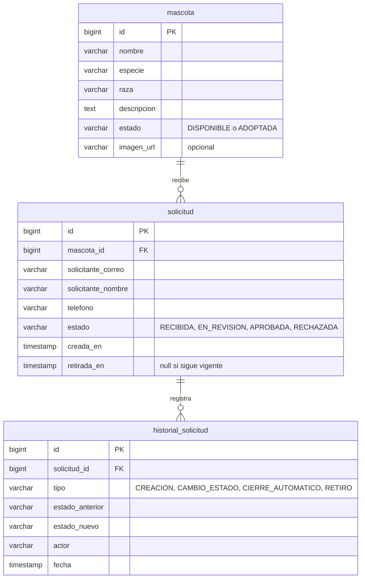

# Adopción responsable de mascotas

Backend (Java 25 + Spring Boot) para una fundacion que publica mascotas y gestiona solicitudes de adopcion con trazabilidad, sin exponer datos de contacto

## Modelo de datos



### Relaciones

- Una mascota recibe muchas solicitudes, cada solicitud pertenece a una sola mascota
- Cada solicitud registra muchos eventos en el historial: creación, cambios de estado, cierres automáticos y retiro

### Notas del modelo

- Retirar una solicitud no borra la fila: se marca `retirada_en`, para conservar la trazabilidad
- `historial_solicitud` solo recibe filas nuevas; nunca se modifica ni se reemplaza
- `solicitante_correo` y `telefono` son datos de contacto: no se devuelven en el catálogo ni en los listados
- La imagen de la mascota es una URL opcional que se guarda como texto

## Cómo ejecutarlo

1. Crear la base `adopcion_responsable` en PostgreSQL y ejecutar `docs/schema.sql` (la app usa `ddl-auto=validate`, así que las tablas deben existir)
2. Opcional: ejecutar `docs/datos-prueba.sql` para cargar tres mascotas de ejemplo
3. Definir las variables de entorno `DB_URL`, `DB_USERNAME` y `DB_PASSWORD` (en `docs/env.example` hay un ejemplo). `application.properties` las lee y no trae valores por defecto, así que sin ellas la app no arranca
4. Ejecutar la clase `AdopcionMascotas`. La API queda en `http://localhost:8080`

### Cómo definir las variables

**IntelliJ IDEA:** *Run > Edit Configurations*, en la configuración de `AdopcionMascotas`, campo *Environment variables*:

```
DB_URL=jdbc:postgresql://localhost:5432/adopcion_responsable;DB_USERNAME=postgres;DB_PASSWORD=tu_clave
```

**VS Code:** copiar `docs/env.example` a `.vscode/.env` con los valores reales y crear `.vscode/launch.json` (la carpeta `.vscode/` no se sube al repositorio):

```json
{
  "version": "0.2.0",
  "configurations": [
    {
      "type": "java",
      "name": "AdopcionMascotas",
      "request": "launch",
      "mainClass": "co.edu.autonoma.adopcionmascotas.AdopcionMascotas",
      "envFile": "${workspaceFolder}/.vscode/.env"
    }
  ]
}
```

Luego ejecutar desde *Run and Debug* con la configuración `AdopcionMascotas`.

## Pruebas manuales

En la carpeta `bruno/` hay una colección de [Bruno](https://www.usebruno.com/) con todas las peticiones, numeradas en el orden del flujo completo. Se abre con *Open Collection* y se elige el entorno `local`.

## Identificación (simulada)

No hay login real. Las peticiones protegidas envían dos cabeceras:

| Cabecera | Valor |
|---|---|
| `X-Rol` | `FUNDACION`, `COORDINADOR` o `SOLICITANTE` |
| `X-Usuario` | Nombre del empleado, o el correo si el rol es `SOLICITANTE` |

Un solicitante solo puede ver y retirar las solicitudes cuyo correo coincide con su `X-Usuario`.

## Endpoints

El detalle de cada petición (objeto de entrada, JSON de respuesta, validaciones y errores) está en [docs/api-endpoints.md](docs/api-endpoints.md).

| Verbo | Ruta | Quién |
|---|---|---|
| GET | `/api/mascotas?estado=` | Público |
| GET | `/api/mascotas/{id}` | Público |
| POST | `/api/mascotas` | Fundación |
| PUT | `/api/mascotas/{id}` | Fundación |
| DELETE | `/api/mascotas/{id}` | Fundación |
| POST | `/api/solicitudes-adopcion` | Público |
| GET | `/api/solicitudes?mascotaId=&estado=` | Fundación, coordinador |
| GET | `/api/solicitudes/{id}` | Personal o solicitante dueño |
| PATCH | `/api/solicitudes/{id}/estado` | Fundación, coordinador |
| DELETE | `/api/solicitudes/{id}` | Solicitante dueño |

## Reglas de negocio y dónde se aplican

| Regla | Dónde |
|---|---|
| RN-01 Una solicitud activa por solicitante y mascota | `SolicitudService.crear` y el índice único `uq_solicitud_activa` |
| RN-02 Estados y transiciones | `SolicitudService.TRANSICIONES` y `cambiarEstado` |
| RN-03 Aprobar deja la mascota `ADOPTADA` | `SolicitudService.cambiarEstado` |
| RN-04 Aprobar cierra las demás solicitudes activas | `SolicitudService.cerrarOtrasSolicitudes` |
| RN-05 Una mascota adoptada no recibe solicitudes | `SolicitudService.crear` |
| RN-06 La imagen es una URL opcional | `MascotaRequest` y el CHECK de la tabla `mascota` |

Transiciones válidas: `RECIBIDA` pasa a `EN_REVISION` o `RECHAZADA`, y `EN_REVISION` pasa a `APROBADA` o `RECHAZADA`. Las solicitudes retiradas no cambian de estado.

## Decisiones de diseño

- Las reglas viven en la capa de servicio. Los controllers solo manejan HTTP
- Se usa Lombok para los getters, setters, constructores y builders de entidades, DTO, servicios y controllers
- Se usan DTO para no exponer las entidades ni los datos de contacto
- Aprobar una adopción es una sola transacción: se cambia la solicitud, la mascota y las demás solicitudes, o no se guarda nada
- Las operaciones que cambian solicitudes bloquean primero la fila de la mascota (`SELECT FOR UPDATE`) para que dos peticiones simultáneas no adopten la misma mascota dos veces
- Todos los errores usan el mismo formato JSON, con el campo `codigo` que indica la regla incumplida (`RN-01`, `RN-02`, `RN-05`, `RN-06`) o el tipo de error
